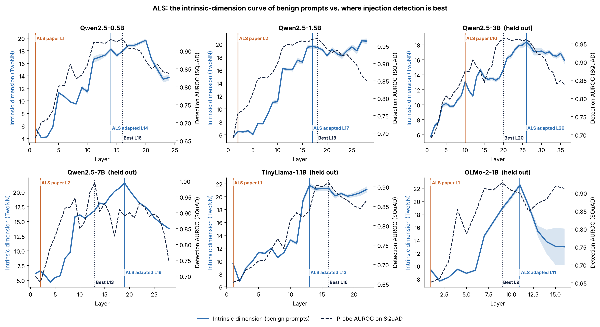
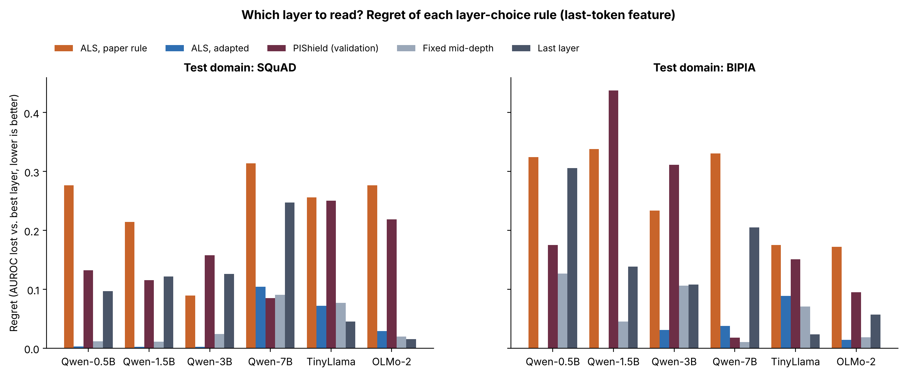
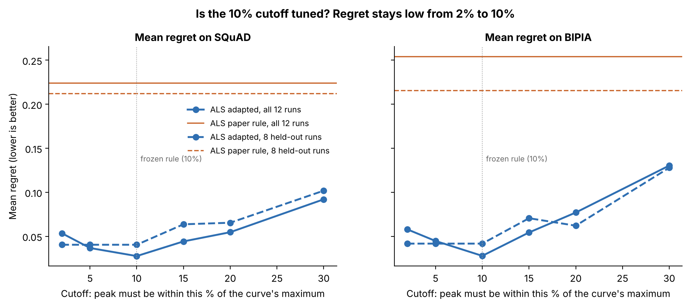
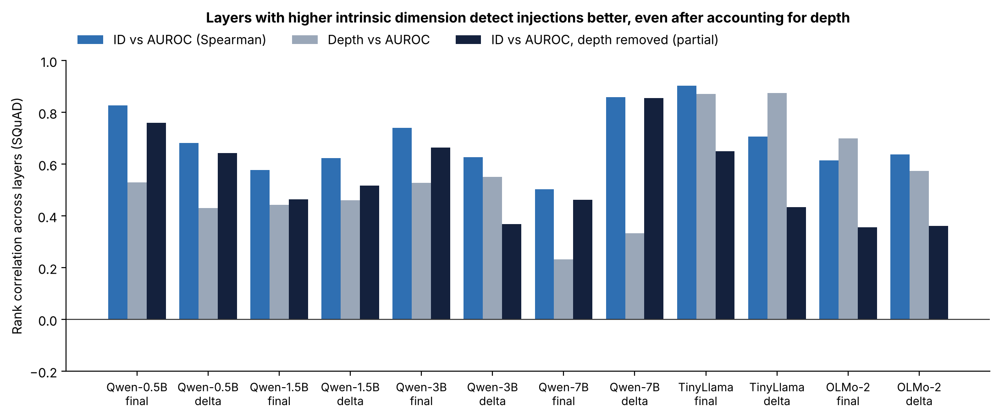
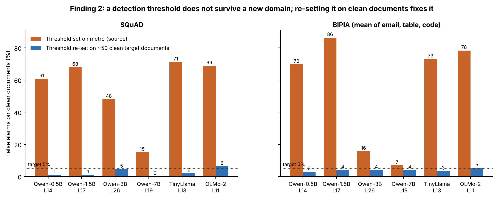
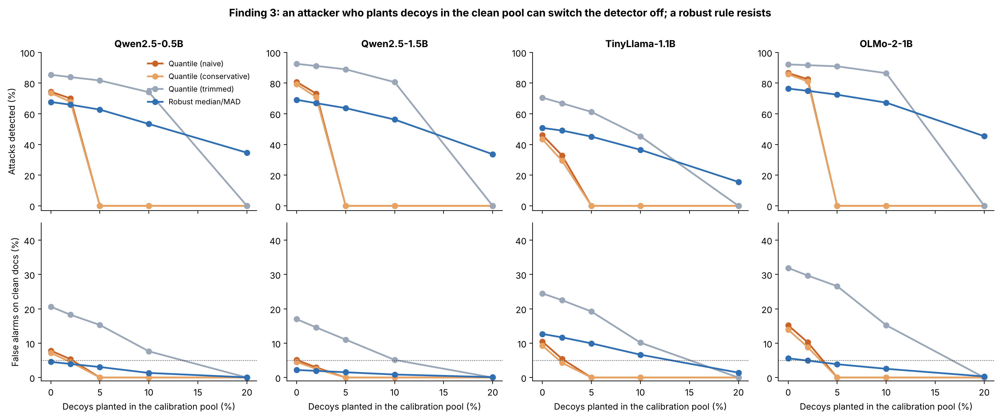
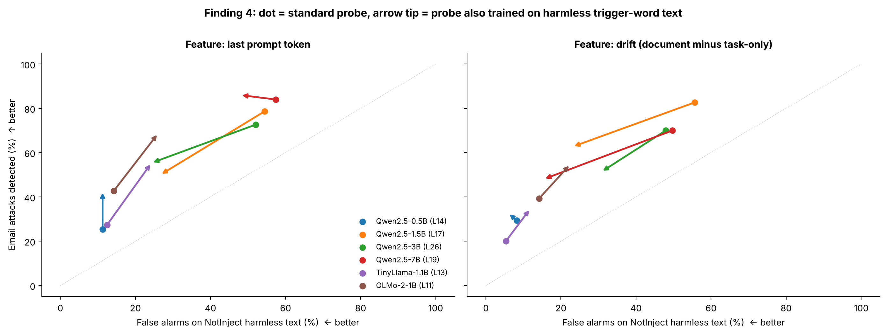
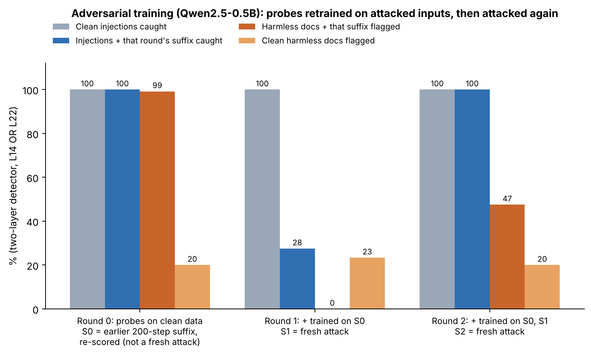
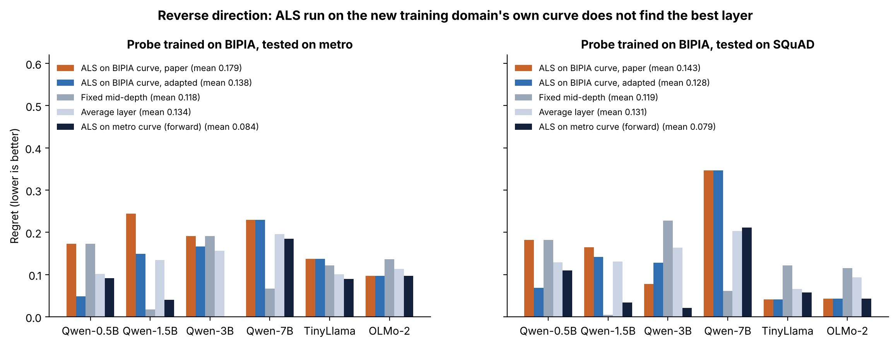

# Figures

Nine result figures, each with a `.md` that explains the question, how to read it, the numbers behind it, the
takeaway and the source data. All are built from files in this repository, without models or hidden states:

```
pip install -r requirements-cpu.txt
python repro/analysis/make_figures.py
```

| # | Figure | Explanation | One-line result |
|---|---|---|---|
| 1 |  | [fig1_id_curves_vs_detection.md](fig1_id_curves_vs_detection.md) | The adapted ALS pick sits at the top of the ID curve, next to the detection plateau; the paper rule lands on an early bump |
| 2 |  | [fig2_layer_choice_regret.md](fig2_layer_choice_regret.md) | Adapted ALS regret 0.036 (SQuAD) / 0.029 (BIPIA) vs 0.160 / 0.198 for PIShield's validation pick |
| 3 |  | [fig3_cutoff_sensitivity.md](fig3_cutoff_sensitivity.md) | Any cutoff from 2% to 10% works; the 10% value is not tuned |
| 4 |  | [fig4_id_vs_detection_correlation.md](fig4_id_vs_detection_correlation.md) | ID tracks detection across layers even after removing depth (+0.36 to +0.86) |
| 5 |  | [fig5_threshold_collapse.md](fig5_threshold_collapse.md) | Finding 2: source threshold flags 61–86% of clean docs; re-setting on ~50 docs gives 0–6% |
| 6 |  | [fig6_poisoned_recalibration.md](fig6_poisoned_recalibration.md) | Finding 3: 5% decoys zero out quantile thresholds; median/MAD keeps 34–45% at 20% (not TinyLlama) |
| 7 |  | [fig7_notinject_tradeoff.md](fig7_notinject_tradeoff.md) | Finding 4: ~50% false alarms on harmless trigger words; training on them halves it at a cost, except at 7B |
| 8 |  | [fig8_adversarial_training.md](fig8_adversarial_training.md) | Two rounds of adversarial training stop a same-budget attack but flag 47% of harmless text with the new suffix |
| 9 |  | [fig9_reverse_direction.md](fig9_reverse_direction.md) | In reverse, ALS on the new domain's curve is no better than a random layer; the metro-curve layer does best |

`figure_numbers.json` holds the exact numbers quoted in the explanations.
