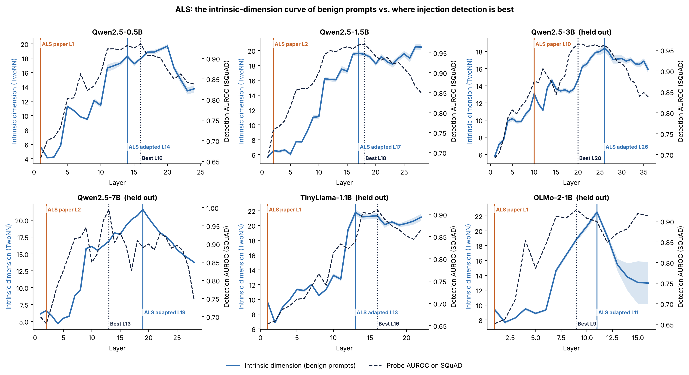

# Figure 1 — ALS: intrinsic-dimension curves vs. where detection is best

## Question
Does the layer that ALS picks from the intrinsic-dimension (ID) curve of **benign** prompts line up with the layer
where a prompt-injection probe detects attacks best?

## How to read it
One panel per model. Layers on the x-axis.
- **Blue line (left axis):** intrinsic dimension of 1,600 benign Pune Metro prompts at each layer (TwoNN, mean of 10
  subsamples; shaded band = ±1 standard deviation). No attack data is used for this curve.
- **Dashed line (right axis):** AUROC of a probe trained on metro and tested on SQuAD (a new domain), at each layer.
  This is only known in hindsight; it is the ground truth the rules are judged against.
- **Orange line:** layer picked by the ALS rule exactly as published (first peak).
- **Blue line:** layer picked by our adapted rule (first peak within 10% of the curve's maximum).
- **Dotted line:** best layer in hindsight.
- "(held out)" marks the four models run only after the adapted rule was frozen.

## What it shows
- The published rule lands on layer 1–2 in five of six models (L10 on Qwen-3B): a small bump right after the
  embeddings, where detection is poor (AUROC 0.65–0.76).
- The adapted rule lands at the top of the curve, which sits on or next to the detection plateau:
  Qwen-0.5B L14 (best L16), Qwen-1.5B L17 (best L18), Qwen-3B L26 (best L20, on the plateau), OLMo-2 L11 (best L9),
  TinyLlama L13 (best L16).
- **Miss:** Qwen-7B — the curve peaks at L19 while detection peaks at L13.

## Takeaway
The ID curve rises as detection improves and tops out near the detection plateau, so a label-free rule can find a good
layer — but only if it skips the early bump. Late layers keep high ID while detection falls (Qwen-1.5B L28), which is
why the rule takes the *first* high peak, not the maximum.

## Source
Data: `results_sweep/<model>/per_layer.json` (fields `id_benign_boots`, `squad_auroc_mean`),
picks from `repro/analysis_out/selection/<model>.json`. Last-token feature.
Regenerate: `python repro/analysis/make_figures.py`.
