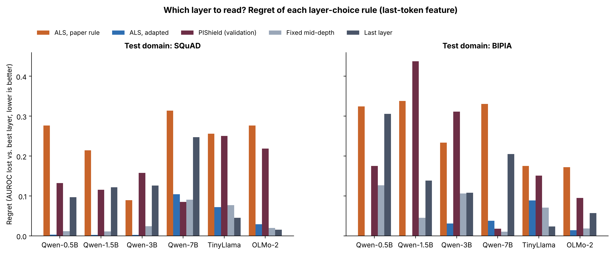

# Figure 2 — Regret of each layer-choice rule

## Question
If you must choose one layer to read before you see the deployment domain, how much detection quality do you lose
with each way of choosing?

## How to read it
- **Regret** = AUROC of the best layer minus AUROC of the chosen layer. 0 = the rule found the best layer; 0.2 = a much
  weaker detector. Lower is better.
- Left: probe trained on metro, tested on SQuAD. Right: same probe tested on BIPIA (email, table, code; mean AUROC).
- Five rules, all chosen using metro data only:
  ALS paper rule (orange), ALS adapted (blue), PIShield = layer with the best validation accuracy on metro
  (needs attack labels, maroon), fixed mid-depth layer, last layer.
- Last-prompt-token feature. A missing bar means regret ≈ 0.

## What it shows (mean over the six models)
| Rule | SQuAD | BIPIA | SQuAD, 4 held-out models | BIPIA, 4 held-out models |
|---|---|---|---|---|
| ALS, paper rule | 0.238 | 0.262 | 0.234 | 0.228 |
| **ALS, adapted** | **0.036** | **0.029** | **0.052** | **0.043** |
| PIShield (validation) | 0.160 | 0.198 | 0.178 | 0.144 |
| Fixed mid-depth | 0.039 | 0.063 | 0.053 | 0.052 |
| Last layer | 0.109 | 0.140 | 0.109 | 0.098 |

- PIShield's validation pick is the worst rule after the paper rule: on metro every early layer separates attacks
  almost perfectly, so it picks layers 2–7, which transfer worst (Qwen-1.5B on BIPIA: 0.44).
- Adapted ALS is best on BIPIA (0.029 vs 0.063 for mid-depth). On SQuAD it only ties a fixed mid-depth layer.
- Exceptions: on Qwen-7B, PIShield and mid-depth beat ALS; on TinyLlama the last layer beats it on BIPIA.

## Takeaway
Choosing the layer by in-domain validation accuracy is the worst practical choice under a domain shift. Adapted ALS
avoids large failures without any attack labels; it does not always find the single best layer.

## Source
`repro/analysis_out/selection/<model>.json` (`picks`, `regret_squad`) and `repro/analysis_out/bench_summary.json`
(`per_layer_mean_auroc`, `oracle_bench_auroc`). Regenerate: `python repro/analysis/make_figures.py`.
