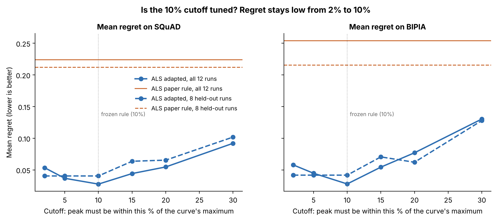

# Figure 3 — Is the 10% cutoff tuned?

## Question
The adapted rule takes the first peak within 10% of the curve's maximum. Would a different number have given very
different results — i.e. did we tune 10% to win?

## How to read it
- x-axis: the cutoff, from 2% to 30%.
- Blue lines: mean regret of adapted ALS at that cutoff. Solid = all 12 runs (6 models × 2 features);
  dashed = the 8 runs on the 4 models that were held out when the rule was frozen.
- Orange lines: the published ALS rule (it has no cutoff, so it is a flat reference).
- Dotted vertical line: the frozen choice, 10%.

## What it shows
| Cutoff | 2% | 5% | **10%** | 15% | 20% | 30% | Paper rule |
|---|---|---|---|---|---|---|---|
| SQuAD, all 12 | 0.053 | 0.037 | **0.028** | 0.044 | 0.055 | 0.092 | 0.224 |
| SQuAD, held-out 8 | 0.040 | 0.040 | **0.040** | 0.064 | 0.065 | 0.102 | 0.212 |
| BIPIA, all 12 | 0.058 | 0.045 | **0.028** | 0.054 | 0.077 | 0.130 | 0.254 |
| BIPIA, held-out 8 | 0.042 | 0.042 | **0.042** | 0.071 | 0.062 | 0.128 | 0.215 |

- On the held-out models, every cutoff from 2% to 10% picks the same layers.
- Above 15% some curves fall back to the early bump (Qwen-3B drift feature picks L4 at 15%).
- Every cutoff tried is far better than the published rule and than PIShield (0.158 on SQuAD).

## Takeaway
The result does not depend on the exact value 10%; anything from about 2% to 10% works. Too loose a cutoff lets the
early bump back in.

## Source
`repro/analysis_out/als_checks/sensitivity.json`, produced by `python repro/analysis/als_checks.py forward`.
Regenerate the figure: `python repro/analysis/make_figures.py`.
