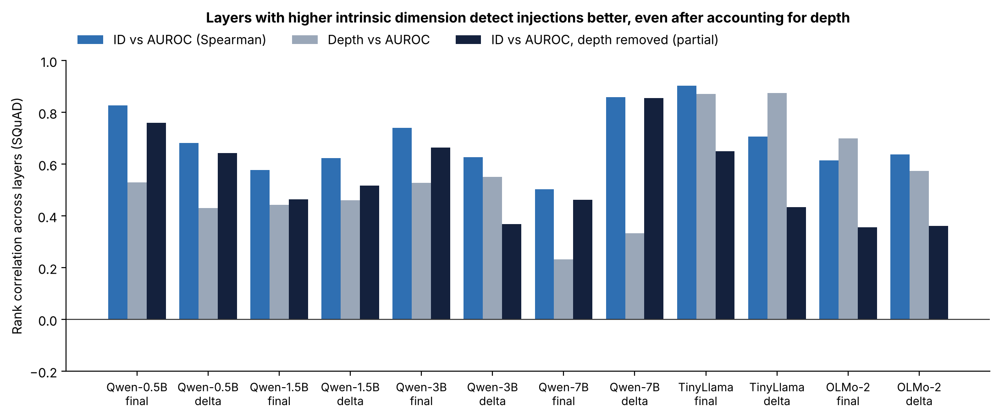

# Figure 4 — Does intrinsic dimension track detection, beyond depth?

## Question
Layers with higher ID should be layers where detection is better. But both ID and detection tend to grow with depth,
so is the ID curve telling us anything beyond "deeper is better"?

## How to read it
One group of bars per model and feature (`final` = last prompt token, `delta` = drift feature). Across that model's layers:
- **Blue:** Spearman rank correlation between ID and SQuAD AUROC (+1 = they rise and fall together).
- **Grey:** rank correlation between plain depth (layer number) and AUROC.
- **Dark:** partial correlation — ID vs AUROC after removing a straight-line effect of depth from both. Positive means
  "where ID is higher than depth alone predicts, detection is also better than depth alone predicts".

## What it shows
- ID vs AUROC: +0.50 to +0.90 in all 12 runs.
- After removing depth: still positive in all 12 runs, +0.36 to +0.86.
- Where depth alone is weak (Qwen-7B: 0.23 and 0.33), ID still tracks detection (0.50 and 0.86).
- Weakest: OLMo-2 (+0.36) and TinyLlama drift (+0.43), where depth already explains most of it.
- On the metro test set (not plotted), the depth-removed correlation is negative once: Qwen-7B final, −0.05.

## Takeaway
The ID curve carries real information about where injections are easiest to detect, beyond depth. This supports
using it to choose layers. It does **not** show *why* — that ID measures "richer understanding of the context" is the
interpretation from prior work (Valeriani et al. 2023; Cheng et al. 2025), not something tested here.

## Source
`repro/analysis_out/id_auroc_correlation.json`, produced by `python repro/analysis/id_auroc_correlation.py`
(full method and code explained in that script). Regenerate the figure: `python repro/analysis/make_figures.py`.
