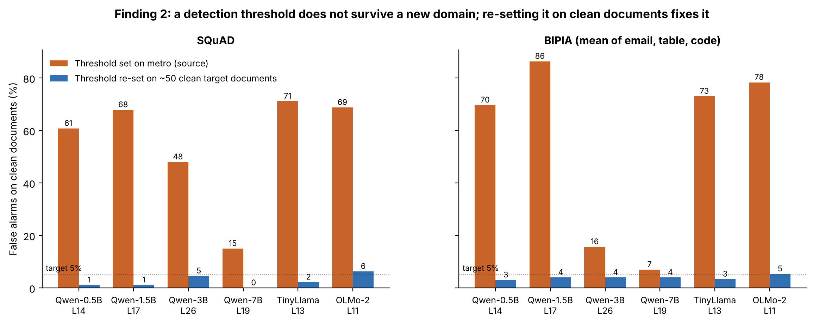

# Figure 5 — Finding 2: threshold collapse and recalibration

## Question
A detector needs a threshold: scores above it are flagged. If the threshold is set for 5% false alarms on the training
domain (metro), does it still give about 5% in a new domain?

## How to read it
At the ALS layer of each model (shown under the model name):
- **Orange:** false alarms on clean documents in the new domain, using the threshold set on metro.
- **Blue:** false alarms after re-setting the threshold on about 50 clean documents from the new domain (no attack
  examples needed). Measured on different documents from the ones used to set it.
- Dotted line: the 5% target. Left: SQuAD. Right: BIPIA, mean of email, table and code.

## What it shows
| Model (ALS layer) | SQuAD, metro threshold | SQuAD, re-set | BIPIA, metro threshold | BIPIA, re-set |
|---|---|---|---|---|
| Qwen-0.5B (L14) | 61% | 1% | 70% | 3% |
| Qwen-1.5B (L17) | 68% | 1% | 86% | 4% |
| Qwen-3B (L26) | 48% | 5% | 16% | 4% |
| Qwen-7B (L19) | 15% | 0% | 7% | 4% |
| TinyLlama (L13) | 71% | 2% | 73% | 3% |
| OLMo-2 (L11) | 69% | 6% | 78% | 5% |

- On the four small models, the metro threshold flags 61–86% of clean documents in a new domain. The larger Qwen
  models collapse less (7–48%).
- Re-setting on ~50 clean documents brings every model back to 0–6%.
- Detection at the re-set threshold on BIPIA is modest: 20–78% of attacks (mean of the three domains).

## Takeaway
A probe detector cannot be shipped with the threshold it was trained with. Re-setting it on a small set of clean
documents from the deployment domain is cheap and works — which leads to Finding 3 (that step can be attacked).

## Source
SQuAD: `results_sweep/<model>/per_layer.json` (`squad_fpr_benign`) and `repro/analysis_out/selection/<model>.json`
(`recal`). BIPIA: `repro/analysis_out/bench_summary.json` (`fpr_src`, `fpr_tgt`, `tpr_tgt`).
Regenerate: `python repro/analysis/make_figures.py`.
