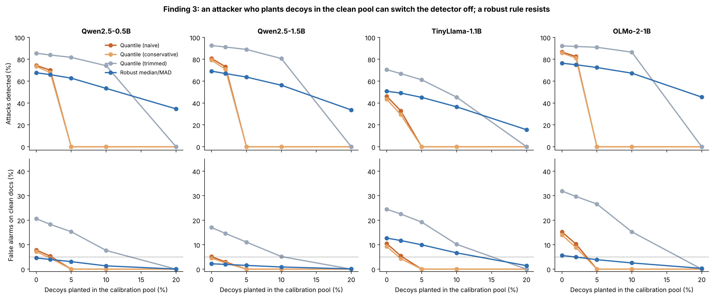

# Figure 6 — Finding 3: poisoned recalibration

## Question
Figure 5's fix re-sets the threshold on documents assumed to be clean. In practice that pool is unlabelled traffic.
What if an attacker plants some documents in it?

## How to read it
x-axis: share of the 200-document calibration pool that is attacker-planted decoys (documents built to score very high).
- **Top row:** attacks detected on held-out SQuAD documents. **Bottom row:** false alarms on clean ones (dotted = 5%).
- Four ways to set the threshold from the pool:
  - Quantile (naive): the 95th percentile of the pool.
  - Quantile (conservative): a slightly higher percentile that guarantees ≤5% false alarms for up to 10% contamination.
  - Quantile (trimmed): a lower percentile that assumes up to 10% contamination.
  - **Robust median/MAD:** threshold = median + k × MAD of the pool, with k learned on metro.

## What it shows
- With **5% decoys**, both naive and conservative quantile rules detect **0%** of attacks on every model: the decoys
  push the 95th percentile above every real score.
- Trimmed quantile survives up to 10% decoys but has high false alarms without decoys (17–32%) and fails at 20%.
- **Robust median/MAD** degrades gradually and keeps false alarms ≤13%. At 20% decoys it still detects 35% (Qwen-0.5B),
  34% (Qwen-1.5B) and 45% (OLMo-2); it fails on TinyLlama (16%), whose clean scores change shape between domains.

## Why (the maths)
If a fraction e of the pool is contamination of unknown distribution and the threshold is the pool's q-quantile, the
clean false-alarm rate is only pinned to the interval [(1 − e − q)/(1 − e), (1 − q)/(1 − e)]. Its width e/(1 − e)
does not depend on q, so no quantile rule can both guarantee its false-alarm rate and resist an attacker who places
the contaminants. The median and MAD have a 50% breakdown point, which is why the robust rule degrades gracefully.

## Takeaway
Recalibration is necessary (Figure 5) but is itself an attack surface. Use a robust statistic, not a plain percentile.

## Source
`repro/analysis_out/contamination_results.json`, produced by `repro/analysis/contamination.py`
(scores at the ALS layer, 200 repetitions per setting). Regenerate: `python repro/analysis/make_figures.py`.
