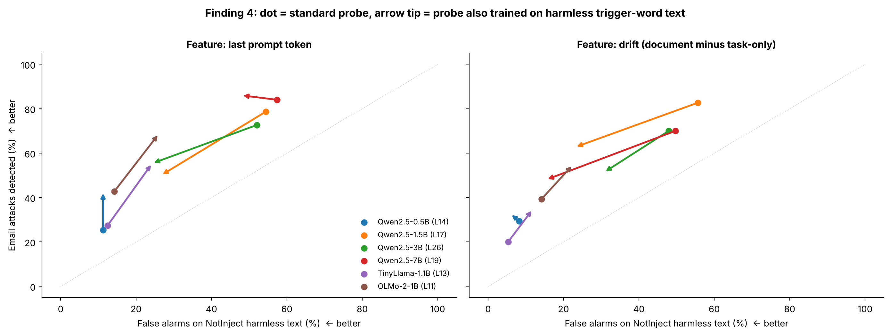

# Figure 7 — Finding 4: harmless trigger words, and what training on them does

## Question
NotInject contains harmless text that uses words like "ignore" or "override". How often do probes flag it, and does
adding such text to training fix that without losing attacks?

## How to read it
Each model is one colour; the probe reads the ALS layer. Thresholds re-set on clean BIPIA emails.
- **x-axis:** false alarms on held-out NotInject documents (left is better).
- **y-axis:** BIPIA email attacks detected (up is better).
- **Dot:** standard probe (trained on metro benign vs attacks).
- **Arrow tip:** same probe, also trained with half of NotInject and benign reader-directed instructions (metro
  family D) as negatives. NotInject is split by context, so the evaluated half was never trained on.
- Left: last-prompt-token feature. Right: drift feature (the legend's layers are for the left panel; TinyLlama's
  drift layer is L11).

## What it shows
| Model · feature | NotInject flagged | Email attacks caught | Attack vs NotInject AUROC |
|---|---|---|---|
| Qwen-1.5B · final | 54% → 27% | 79% → 50% | 0.71 → 0.65 |
| Qwen-1.5B · drift | 56% → 23% | 83% → 63% | 0.74 → 0.74 |
| Qwen-3B · final | 52% → 24% | 73% → 55% | 0.67 → 0.69 |
| Qwen-3B · drift | 48% → 31% | 70% → 51% | 0.66 → 0.67 |
| Qwen-7B · final | 57% → 48% | 84% → 86% | 0.66 → 0.80 |
| Qwen-7B · drift | 50% → 15% | 70% → 48% | 0.65 → 0.73 |
| Qwen-0.5B, TinyLlama, OLMo-2 | 5–14% → 6–26% | 20–43% → 33–69% | 0.58–0.69 → 0.64–0.77 |

- The larger Qwen models flag about half of NotInject — scale makes it worse, not better.
- Training on trigger-word text moves most arrows down-left: fewer false alarms *and* fewer attacks caught. The
  separability (last column) barely moves on 1.5B and 3B, so this is mostly a threshold trade-off.
- **Qwen-7B (last token)** is the exception: false alarms fall while detection holds (84% → 86%), and separability
  rises 0.66 → 0.80.
- The small models already flag little NotInject (they also catch fewer attacks); the extra negatives mostly raise
  their detection, and their false alarms.

## Takeaway
Telling harmless trigger words from real injections is the main open weakness of probe detectors. Training on them
helps only partly, except at 7B.

## Source
`repro/analysis_out/notinject/<model>/ni_per_layer.json` (variants `std` and `ni_hard`), produced by `ni_eval.py`.
Regenerate: `python repro/analysis/make_figures.py`.
