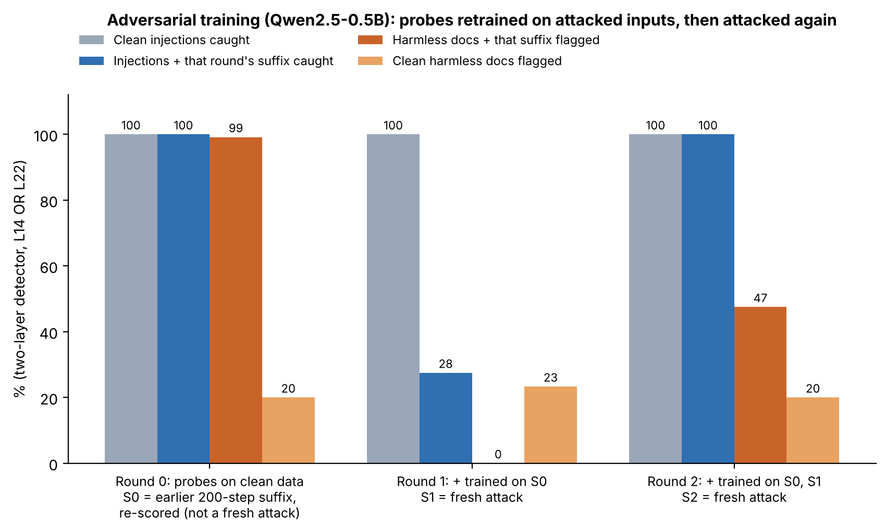

# Figure 8 — Adversarial training against a white-box attacker

## Question
A white-box attacker (knows the model and the probe weights) can learn a universal suffix that, appended to an
injection, hides it from the probes. If the defender retrains the probes on suffix-attacked injections, does a fresh
attack with the same budget still get through — and what does the defence cost?

## Setup
Qwen2.5-0.5B, detector = layer 14 OR layer 22 (flag if either fires). Each round: retrain both probes on clean data
plus every suffix found so far (attacked injections as positives, harmless documents with the same suffix as
negatives), then run a fresh 200-step attack against the retrained probes. Tested on 120 held-out injections and 120
held-out harmless documents.

## How to read it
Four bars per round:
- grey: clean injections caught;
- blue: injections carrying that round's suffix caught;
- dark orange: harmless documents carrying that round's suffix flagged (a false alarm);
- light orange: clean harmless documents flagged.

## What it shows
- **Round 0** is not a fresh attack. S0 is the suffix from the earlier 200-step attack, which against *its own*
  probes cut the two-layer detector from 100% to 57% (see `repro/report`). Re-scored here against freshly trained
  probes, it does not transfer (100% caught), but the gibberish suffix itself trips layer 14, so 99% of harmless
  documents carrying it are flagged.
- **Round 1** (probes also trained on S0): a fresh attack finds S1, which evades — only 28% caught. Old S0 is now
  caught 100%.
- **Round 2** (trained on S0 and S1): the fresh attack fails — 100% caught, and S0, S1 are caught 99%. But harmless
  documents carrying the new suffix S2 are flagged 47% of the time.
- Clean harmless documents are flagged ~20% in every round: a calibration gap at layer 22, unrelated to the attack.

## Takeaway
Adversarial training learns each attack it has seen and, after two rounds, stops a same-budget attacker — at the cost of
flagging odd but harmless text. One model, two rounds, a fixed budget: this is not evidence of robustness against a
stronger attacker.

## Source
`repro/analysis_out/advtrain/adv_round{0,1,2}.json` and `adv.log`, produced by `adversarial_train.py` (job81).
Regenerate: `python repro/analysis/make_figures.py`.
