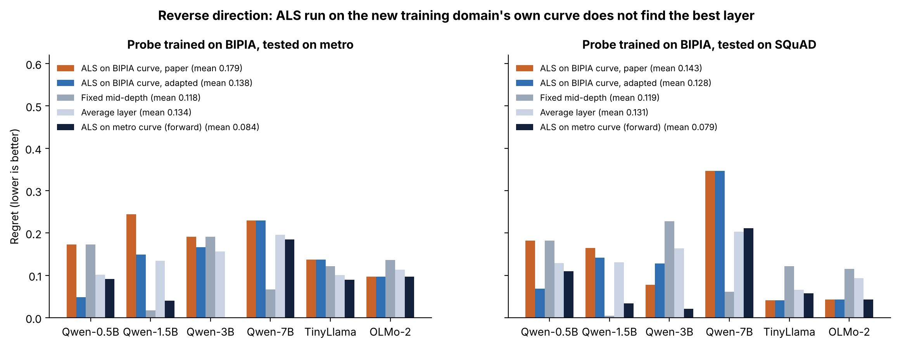

# Figure 9 — Reverse direction: does ALS adapt to a new training domain?

## Question
Everything else trains on metro. Here the probe is trained on BIPIA (email and table) and tested on metro and SQuAD.
If ALS is run on the new training domain's own ID curve (benign BIPIA prompts), does it find the best layer for this
direction?

## How to read it
Regret per model (lower is better) for five ways of choosing the layer:
- ALS on the BIPIA curve, paper rule and adapted rule (260 benign BIPIA email + table prompts, 10 subsamples of 80%);
- a fixed mid-depth layer;
- an "average layer" (the regret of a randomly chosen layer);
- the layer ALS picked from the original metro curve (1,600 prompts), reused as-is.

Legend values are means over the six models.

## What it shows
| Rule | Regret, tested on metro | Regret, tested on SQuAD |
|---|---|---|
| ALS on BIPIA curve, paper | 0.179 | 0.143 |
| ALS on BIPIA curve, adapted | 0.138 | 0.128 |
| Fixed mid-depth | 0.118 | 0.119 |
| Average layer | 0.134 | 0.131 |
| **ALS on metro curve (forward layer)** | **0.084** | **0.079** |

- ALS run on the BIPIA curve is no better than picking a layer at random.
- The layer chosen from the metro curve is the best of the five, even though the probe is now trained on BIPIA.
- The best layer itself moves in this direction: early layers (L3–L8) on metro for Qwen-0.5B, Qwen-7B, TinyLlama and OLMo-2.

## Takeaway
ALS finds a good layer *for a model*, but here it did not track how the best layer moves when the training domain
changes. Likely cause, not yet tested: 260 short, templated BIPIA prompts give a noisier curve than 1,600 metro
prompts. Subsampling the metro curve to 260 prompts would test this.

## Source
`repro/analysis_out/als_checks/reverse.json` (`python repro/analysis/als_checks.py reverse`) and
`results_sweep/reverse/<model>/reverse_per_layer.json` (from `reverse_eval.py`).
Regenerate: `python repro/analysis/make_figures.py`.
